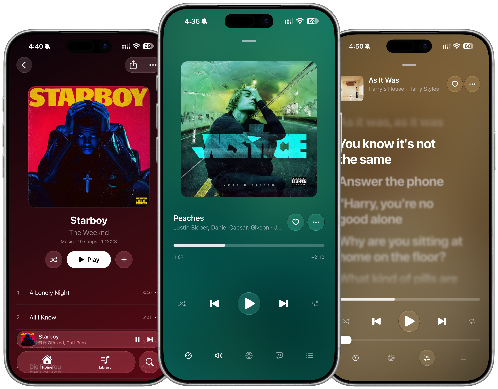

<p align="center">
  
</p>

<h1 align="center">LiquidTune</h1>
<p align="center">Liquid Glass Designed music player for iOS</p>

Play music from your Jellyfin or Subsonic server, or import audio files directly from the Files app.

<p align="center">
  
</p>

## Features

- **Music sources** — Stream from Jellyfin, Subsonic, and compatible OpenSubsonic servers, or play music stored on your device.
- **Library and queue** — Browse albums, artists, songs, genres, and playlists. Search your library, reorder the queue, and save favorites.
- **Synced lyrics** — Follow timestamped Jellyfin lyrics as they scroll, or tap a line to jump to that part of the song.
- **Instant Mix** — Start with any song and generate a new queue of related tracks. LiquidTune uses Jellyfin recommendations when available and can also match songs by artist and genre.
- **Artwork and playback** — The player uses colors from the album cover. Background audio, lock-screen controls, and AirPlay are supported.

The screen stays awake while the full-screen player, lyrics, or queue is open.

## Download

Requires **iOS or iPadOS 26.0 or later**.

<a href="https://github.com/ACOPS1206/LiquidTune/actions/runs/44715837904/artifacts/14619766331">
  
</a>

Open the latest successful [GitHub Actions build](https://github.com/ACOPS1206/LiquidTune/actions/workflows/ipa.yml) and download the **LiquidTune-unsigned-ipa** artifact. Extract the ZIP to get `LiquidTune-unsigned.ipa`. The IPA requires signing before installation.

## Build from source

Open `LiquidTune.xcodeproj` in **Xcode 26 or later** and select the **LiquidTune** scheme. Choose a simulator or a connected device to run the app.

To build an unsigned IPA from the repository root, run:

```bash
bash Scripts/build-unsigned-ipa.sh
```

The script writes the IPA to `build/LiquidTune-unsigned.ipa`.

## Credits and license

LiquidTune began as an iOS port inspired by [LineageOS Twelve](https://github.com/LineageOS/android_packages_apps_Twelve). It is licensed under the [Apache License 2.0](LICENSE). See [NOTICE](NOTICE) for attribution.
